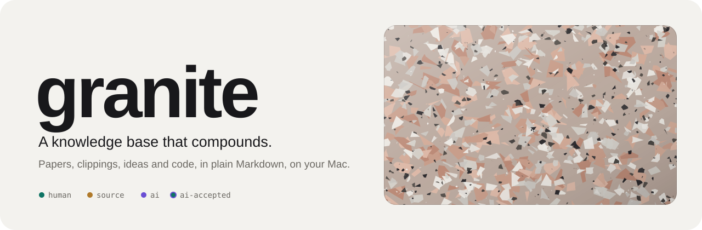
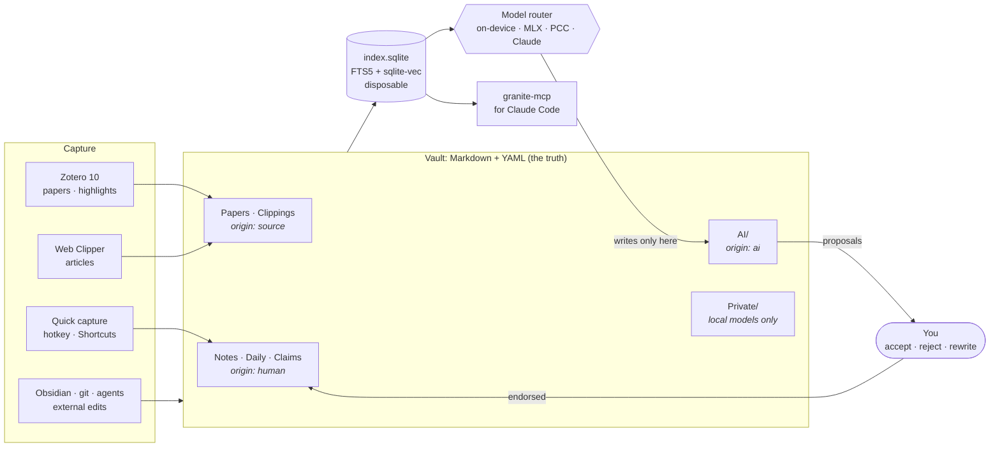

<p align="center">
  <picture>
    <source media="(prefers-color-scheme: dark)" srcset="assets/banner-dark.svg">
    
  </picture>
</p>

<p align="center">
  
  
  
  
  
  
</p>

<p align="center">
  <b>A personal, native Mac knowledge base for everything I know:</b><br>
  research papers, web clippings, my own writing, and the decisions behind my code.<br>
  Plain files you own. An index you can throw away. An AI that cites, proposes, and asks before it tells.
</p>

<p align="center">
  <a href="docs/MASTER-PLAN.md"><b>Master plan</b></a> ·
  <a href="#why-it-compounds">Why it compounds</a> ·
  <a href="#how-it-works">How it works</a> ·
  <a href="#stack">Stack</a> ·
  <a href="#roadmap">Roadmap</a> ·
  <a href="docs/research">Research</a>
</p>

---

## The idea

Most knowledge tools are good at storage, and storage is not what compounds. Research behind this project found that what pays off over years is **writing claims in your own words, linking them, and having output pull them back out**. One audited Obsidian vault took in 79 clippings and 142 AI items in 90 days, and one note its owner wrote.

granite is built around that finding. It makes capture instant, makes processing the default next step, and keeps every piece of text honest about where it came from. Granite is crystals of quartz, feldspar and mica that stay distinct inside one durable whole. The vault works the same way.

## Why it compounds

<table>
  <tr>
    <td width="50%" valign="top">
      <h3>◆ Provenance on everything</h3>
      Every file and every AI sentence carries an <code>origin</code>: <code>human</code>, <code>source</code>, <code>ai</code> or <code>ai-accepted</code>. Answers cite only your notes and your sources, never the AI's own summaries, so the corpus can't slowly start quoting itself.
    </td>
    <td width="50%" valign="top">
      <h3>◆ Beliefs over time</h3>
      Claims are dated and <i>superseded</i>, never overwritten. A quarterly belief diff answers "what did I think in March, and what changed my mind?" Hindsight bias makes that impossible from memory alone.
    </td>
  </tr>
  <tr>
    <td width="50%" valign="top">
      <h3>◆ One graph across types</h3>
      Paper → highlight → claim → idea → decision → commit, linked with typed links. Zotero annotations become citable blocks, and code decisions link to the commits that carried them out.
    </td>
    <td width="50%" valign="top">
      <h3>◆ A research agent that stays honest</h3>
      Hybrid search over your own files, answers with script-verified passage citations, and "I have no note on that" when it doesn't know. It runs on-device where it can and proposes changes instead of making them.
    </td>
  </tr>
</table>

## How it works



The vault is an ordinary folder that Obsidian can open. granite never stores knowledge anywhere else: the SQLite index lives outside the vault and can be rebuilt from scratch at any time.

```text
~/Vault/
  AGENTS.md          rules for any AI agent working in the vault
  .granite/          policy.yaml (folder → AI privacy label), review log, eval set
  Inbox/             zero-friction captures, nudged toward processing
  Notes/  Daily/     your writing                         origin: human
  References/        people, books, tools                  origin: human
  Papers/            Zotero literature notes               origin: source + your take
  Clippings/         web articles, transcripts             origin: source · untrusted
  Code/              decision records linked to commits    origin: human
  AI/                index, digests, proposals, wiki       origin: ai · regenerable
  Private/           never leaves the Mac                  ai: local
  Archive/  Attachments/  Templates/
```

## Stack

| Layer | Choice | Why |
|---|---|---|
| App | **Swift 6**, SwiftUI + AppKit, macOS 27 | First-class access to Foundation Models, MLX, PDFKit, App Intents and Spotlight. About 85–90% of the code. |
| Editor | **CodeMirror 6** in a `WKWebView` (TypeScript) | Obsidian-grade live preview at 50k lines, where TextKit 2 still has documented problems with long files. |
| Index | **GRDB** + SQLite **FTS5** + **sqlite-vec** | One disposable file, keyword plus vector search, rebuilt from Markdown. |
| Retrieval | BM25 + EmbeddingGemma + Qwen3 reranker, one hop along wikilinks | Hybrid search and reranking cut retrieval failures by up to 67% in Anthropic's tests. Your links are the knowledge graph. |
| Models | Apple on-device · MLX local · Apple PCC · Claude | Routed per task and per folder privacy label through one `LanguageModelSession` API. |
| Papers | **Zotero 10** local API (read + write) | Zotero owns capture, metadata, PDFs and citations. granite owns claims, links and synthesis. |
| Agents | `granite-mcp` (Swift MCP server) + `granite-cli` | Claude Code and Claude Desktop can search and cite the vault, and can only *propose* changes. |
| History | git auto-commit + deletion alarm + Time Machine | Every change is reversible, including an agent's. |

Rust and Python stay out of the shipped app. Rust is the fallback if search fails a 100k-note benchmark, and Python is for experiments.

## Roadmap

| | Phase | Weeks | You get |
|:-:|---|:-:|---|
| ◇ | **0 · Spikes** | 1 | Editor, index, Zotero and MCP proven on 50k-note fixtures, or a fallback chosen |
| ◇ | **1 · Daily driver** | 2–6 | Editor, search, backlinks, daily notes, capture hotkey, inbox, git history, read-only MCP |
| ◇ | **2 · Grounded memory** | 7–11 | Hybrid search, inline related notes, Zotero literature notes, cited Q&A, proposal queue |
| ◇ | **3 · Compounding loops** | 12–17 | Claim ledger, FSRS review, nightly digest and lint, weekly Socratic review, metrics |
| ◇ | **4 · Edge** | 18–24 | Code-decision records, literature-graph expansion, trails, contradiction alerts, belief diffs |

Every phase has a "done when" test in the [master plan](docs/MASTER-PLAN.md#8-phased-roadmap).

## Principles

1. **File over app.** Markdown and flat YAML are the truth. The index is disposable.
2. **AI writes only to `AI/`.** Everything else changes through proposals you accept.
3. **Evidence comes from you and your sources,** never from the AI's own summaries.
4. **Socratic by default.** Thinking features ask for your view first.
5. **Supersede, never overwrite.**
6. **Private by folder,** enforced in code, not in prompts.
7. **Instant capture, prompted processing.**
8. **Precision over volume.** Suggestions run on a budget, and a feature whose suggestions you rarely accept gets switched off.

**Not building:** a schema builder, an infinite canvas as storage, lifelogging, uncited AI answers, a graph hairball, or cloud-only storage.

## Repository

```text
granite/
  README.md
  CLAUDE.md                 rules for coding agents
  project.yml               XcodeGen spec (run `xcodegen`; the .xcodeproj is not committed)
  App/                      thin SwiftUI shell: open a vault, search, edit (Bridges/ hosts the editor)
  Editor/                   CodeMirror 6 editor (TypeScript, Vite, Vitest); builds into App/Resources/editor
  Packages/
    KBCore/                 vault model, frontmatter, Obsidian-syntax parser, policy, SafeWriter
    KBIndex/                GRDB index.sqlite, reconcile, FTS5 search, backlinks
    KBTestSupport/          deterministic fixture-vault generator
  Tools/granite-cli/        fixture · index · search · titles · backlinks · stats · eval · parse
  Tests/AppTests/           app tests (editor bridge round-trip)
  scripts/test-all.sh       swift test, Vitest and the editor build (+ --app for the app's tests)
  docs/
    MASTER-PLAN.md          architecture, schemas, AI layer, roadmap, first 10 days
    specs/                  one spec per feature
    decisions/              spike outcomes and design decisions
    research/               three research reports, raw notes, illustrated report
  assets/                   banner art
```

Try it on a synthetic 50k-note vault:

```bash
cd Tools/granite-cli && swift build -c release
.build/release/granite-cli fixture --notes 50000 --out /tmp/g50k
.build/release/granite-cli index --vault /tmp/g50k --db /tmp/g50k-index/index.sqlite
.build/release/granite-cli search --vault /tmp/g50k --db /tmp/g50k-index/index.sqlite some words
```

The remaining packages (`KBReview`, `KBZotero`, `KBCapture`, `KBAI`, `KBCode`) arrive with their phases.

## Research

granite is built on three rounds of research, all in [`docs/research`](docs/research):

- [01 · Compounding Obsidian knowledge base](docs/research/reports/01%20Compounding%20Obsidian%20knowledge%20base.md): method, structure, tooling, habits
- [02 · Sync, AI and the knowledge corpus](docs/research/reports/02%20Obsidian%20sync%20AI%20and%20knowledge%20corpus.md): free sync, AI agents, retrieval, first principles
- [03 · Zotero and the native Mac app](docs/research/reports/03%20Zotero%20and%20native%20Mac%20app.md): Zotero 10, language and stack, Mac foundation, AI layer, feature landscape

---

<p align="center"><sub>A personal project. Built slowly, like the rock.</sub></p>
